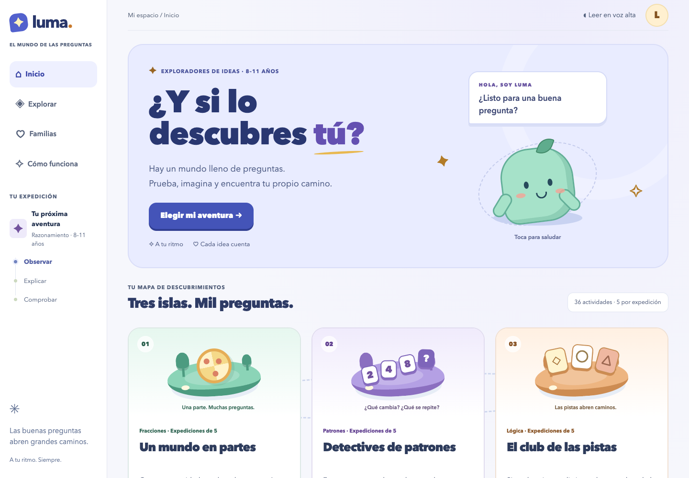

<p align="center">
  
</p>

# Luma

A space to think, explain and discover.

[](https://github.com/Fernise/luma-learning/actions/workflows/ci.yml)
[](LICENSE)
[](#development-approach)

A Spanish-language local learning app with 36 fraction, pattern and logic activities, adaptive tutoring and optional AI interpretation.

**Technology:** Node.js · Built-in SQLite · Browser JavaScript · Optional AI

[Overview](#what-it-does) · [Quick start](#quick-start) · [Architecture](docs/ARCHITECTURE.md) · [Verification](docs/VERIFICATION.md)

## What it does

For Spanish-speaking children aged 8–11 and families exploring fractions, patterns and logic.

- Three illustrated learning islands and 36 authored activities.
- Adaptive expeditions with progressive support and a final new-context problem.
- A local reasoning engine; optional AI interpretation cannot override incorrect answers.
- Opt-in local progress, resume/export/delete controls and adult review material.

## Project status

Local beta 0.9.9, intended for adult evaluation before use with children. Authored age/difficulty bands and pedagogical effectiveness are provisional. It records practice behavior rather than a validated measure of learning.

## Preview



Captured from a local source-only preview without real accounts or private records.

## Quick start

Requires Node.js 22.13+ with `node:sqlite`. No runtime dependencies need installing.

```sh
git clone https://github.com/Fernise/luma-learning.git
cd luma-learning
npm run dev
```

Open `http://127.0.0.1:4173`. Local tutoring works without an API key. The server binds to loopback. Optional AI settings are listed in `.env.example`; leave them blank to remain offline.

Progress persistence is opt-in and local to `data/`. Never commit learner records or written input. See [configuration](docs/CONFIGURATION.md) and the [adaptive tutoring specification](docs/tutor-adaptativo.md).

## Verification

```sh
npm test
npm run review:educator
```

The `pretest` step regenerates fictional educator review material from source. Tests cover tutoring, adaptation, AI boundaries, local storage, recovery and HTTP security without calling paid providers. Commands ending in `:live` explicitly require a configured provider and are not part of CI.

## Repository map

| Path | Responsibility |
| --- | --- |
| `server.js` | Loopback HTTP server and session routes |
| `lib/` | Tutoring, reasoning, adaptation, persistence and evaluation cases |
| `public/` | Learning interface and browser interaction modules |
| `test/` | Offline behavioral and security regressions |
| `scripts/` | Reproducible evaluation and adult-review tools |
| `docs/` | Developer guidance and selected Spanish product specifications |

## Documentation

- [Verification record and limits](docs/VERIFICATION.md)
- [Architecture and data boundaries](docs/ARCHITECTURE.md)
- [Configuration](docs/CONFIGURATION.md)
- [Security policy](SECURITY.md)
- [Contribution guidance](CONTRIBUTING.md)
- [Third-party notices](THIRD_PARTY_NOTICES.md)

## Development approach

Created and directed by **[Fernando · @Fernise](https://github.com/Fernise)** using agentic programming with **OpenAI Codex**. Product direction, requirements and final decisions are the author’s; coding agents contributed to implementation, refactoring, documentation and testing.

See the [verification record](docs/VERIFICATION.md) for completed checks and known limitations.

## License

Publicly viewable source; **all rights reserved**. No open-source reuse license is granted. See [LICENSE](LICENSE).

Third-party libraries and assets retain their own licenses.
